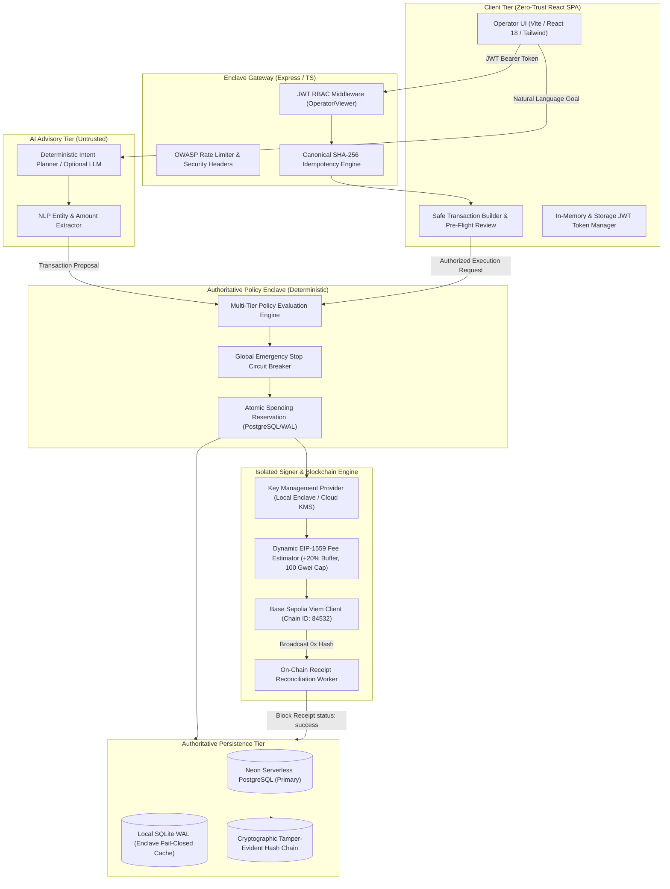

# NEXUS AI WALLET — TECHNICAL SPECIFICATION & ARCHITECTURE
**Competition Submission**: Shenzhen International FinTechathon 2026 — Topic F (Autonomous On-Chain Wallet)  
**System Version**: 1.0.0-institutional  
**Target Blockchain**: Base Sepolia (EVM Chain ID: `84532`)  
**Architecture Pattern**: Enclave Separation of AI Intent Planning & Deterministic Policy Enforcement  

---

## 1. System Overview & Problem Statement

### 1.1 Problem Statement
Autonomous AI agents in Web3 routinely suffer from one of two failure modes:
1. **Unconstrained Custody Risk**: Giving an AI model direct access to private keys or signing capabilities exposes funds to prompt injection, hallucinated transactions, and catastrophic financial loss.
2. **Brittle Manual Oversight**: Requiring human transaction signing for every micro-action defeats the purpose of autonomous treasury management, algorithmic arbitrage, and programmatic liquidity rebalancing.

### 1.2 The NEXUS AI Solution
NEXUS AI establishes an institutional **Air-Gapped Enclave Architecture** that separates **Advisory AI Intent Planning** from **Authoritative Server-Side Policy Enforcement**:
- An untrusted AI agent interprets natural-language goals and drafts structured transaction proposals.
- A deterministic, stateful Policy Engine intercepts every proposal **prior to cryptographic signing**, validating hard spending caps, daily rolling velocity budgets, recipient allowlists, and global circuit-breaker halts.
- Only policy-cleared transactions are signed via an isolated Signer Provider and broadcast to the **Base Sepolia** test network.
- Every state transition, proposal, authorization, and receipt is immutably anchored in an append-only, SHA-256 cryptographic **Audit Hash Chain** backed by dual-layer persistence (Neon PostgreSQL + local SQLite WAL).

---

## 2. High-Level Architecture Diagram

---

## 3. Core Subsystems & Technical Details

### 3.1 AI Advisory Intent Planning (`server/src/ai/planner.ts`)
The intent engine extracts structured transaction proposals from user requests:
- **Input**: Freeform string (e.g., *"Send 0.005 ETH to approved treasury recipient"*).
- **Processing**:
  - Deterministic regex entity extractor parses target recipient (`0x[a-fA-F0-9]{40}`), numeric amount, token symbol (`ETH`, `USDC`, `WBTC`, `ARB`), and action (`transfer`, `swap`, `stake`).
  - Fallback to agent allowlisted recipient if unspecified, assigning confidence score `0.75` vs `0.95`.
  - Zero/negative amounts or unresolvable recipients produce an explicit invalid proposal with advisory reason.
- **Security Boundary**: The AI planner's output is **untrusted input**. The AI possesses zero signing capability and cannot override policy thresholds.

### 3.2 Pre-Flight Simulation & Cryptographic Binding (`server/src/blockchain/simulator.ts`)
Before presenting a proposal for authorization:
1. **Chain Guard**: Strictly asserts `chainId === 84532` (Base Sepolia). Rejects Ethereum Mainnet (Chain 1) and unauthorized networks.
2. **Gas Estimation**: Performs dynamic RPC fee queries (`maxFeePerGas`, `maxPriorityFeePerGas`) applying a +20% buffer capped at 100 Gwei.
3. **Affordability Analysis**: Asserts `currentBalanceEth >= amountEth + maxFeeEth`. Calculates exact shortfall if insufficient.
4. **Cryptographic Binding Hash**: Computes SHA-256 fingerprint:
   $$\text{PayloadHash} = \text{SHA256}(\text{chainId} \parallel \text{from} \parallel \text{to} \parallel \text{amountEth} \parallel \text{calldata})$$
   If any parameter is tampered with between simulation and authorization, execution halts immediately with **HTTP 409 Conflict**.

### 3.3 Server-Side Policy Engine (`server/src/policy/engine.ts`)
Independent safety validation evaluates 6 deterministic checks:
1. **Agent Status Check**: Agent must be in `active` state (`paused` or `stopped` agents blocked).
2. **Global Circuit Breaker**: Emergency killswitch must be disengaged.
3. **Network Allowlist**: Target chain must match authorized testnets (Base Sepolia `84532`, Arbitrum Sepolia `421614`).
4. **Single-Transaction Cap**: Proposal amount must not exceed `agent.maxTxAmount` or policy-level caps.
5. **Daily Velocity Budget**: Cumulative 24-hour spend plus current proposal must not exceed `agent.dailyLimit`.
6. **Recipient Allowlist**: Target address must reside in the agent's pre-approved recipient array.

### 3.4 Cryptographic Audit Hash Chain (`server/src/audit/hashChain.ts`)
Every security event and execution outcome is anchored in a block-chained audit ledger:
$$\text{RecordHash}_n = \text{SHA256}(\text{RecordHash}_{n-1} \parallel \text{RecordPayload}_n)$$
- Genesis block starts at `0000000000000000000000000000000000000000000000000000000000000000`.
- Verification is **read-only**: Any manual modification of historical database rows is immediately detected and pinpointed.

### 3.5 Key Management Architecture (`server/src/blockchain/keyManagement.ts`)
The `KeyManagementProvider` interface abstracts transaction signing:
- **`LocalTestnetSignerProvider`**: Used for development testnets. Explicitly flagged with `isProductionReady = false`. Fails closed if invoked for Chain ID 1 (Ethereum Mainnet).
- **`CloudKmsHsmProvider`**: Enterprise cloud KMS interface (AWS KMS / GCP Cloud HSM). Fails closed if enterprise credentials are not provisioned.
- **Client Isolation**: Private keys never touch browser memory, Vite environment variables, or client bundles.

---

## 4. REST API Specification

| Endpoint | Method | Auth | Description |
| :--- | :---: | :---: | :--- |
| `/api/auth/login` | `POST` | Public | Authenticates operator, issues access token & refresh token. |
| `/api/auth/refresh` | `POST` | Public | Rotates refresh token; detects and revokes on replay attacks. |
| `/api/auth/register` | `POST` | Public (Rate-Limited) | Creates new operator profile with scrypt hashed password. |
| `/api/wallet/status` | `GET` | Public | Live Base Sepolia telemetry (address, balance, nonce, killswitch). |
| `/api/wallet/simulate` | `POST` | Public | Pre-flight simulation, affordability analysis, and binding hash. |
| `/api/wallet/execute-safe` | `POST` | Operator JWT | Authorized execution with policy check, signing, and broadcast. |
| `/api/agents` | `GET` | Public | Retrieves all configured agents and velocity metrics. |
| `/api/agents` | `POST` | Operator JWT | Registers a new autonomous agent with custom limits. |
| `/api/policies` | `GET` | Public | Lists active spending policies and velocity constraints. |
| `/api/policies` | `POST` | Operator JWT | Creates or updates institutional spending rules. |
| `/api/security/emergency-stop` | `POST` | Operator JWT | Engages global circuit breaker, halting all signing operations. |
| `/api/security/resume` | `POST` | Operator JWT | Disengages emergency stop following administrative review. |
| `/api/monitoring/audit-chain/verify` | `GET` | Operator JWT | Executes read-only cryptographic verification of hash chain. |

---

## 5. Technology Stack

- **Frontend**: React 18, TypeScript, Vite 5, Tailwind CSS, Lucide Icons, Framer Motion, Recharts.
- **Backend**: Node.js v24, Express 4, TypeScript 5.5, Viem 2.19, Better-SQLite3, PG (Neon), Zod 3.23.
- **Blockchain**: Base Sepolia (`chainId: 84532`), EIP-1559, JSON-RPC.
- **Security**: Scrypt password hashing, HMAC-SHA256 JWT, SHA-256 hash chaining, express-rate-limit.
